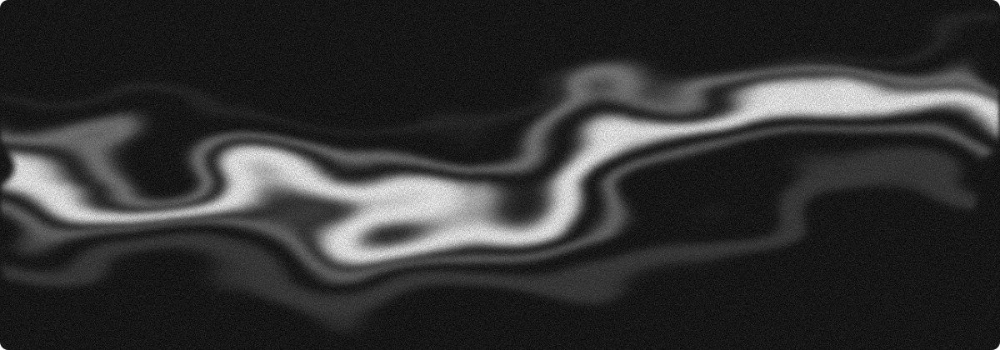

  

  
  
  
  
  
  

  

<table>
  <tr>
    <td>
      <h2>About me</h2>
      
<b>Adriel O'Connel</b> — 27, South American, ADHD.

      
Contributor at <a href="https://github.com/MetrolistGroup/Metrolist"><b>Metrolist</b></a> — a modern YouTube Music client for Android. Mostly through code, reviews, and general project support.

      
I don't have much to say, but if you find information about me just put it there.

    </td>
    <td width="140" align="center">
      
    </td>
  </tr>
</table>

<h2 align="center">What I work with</h2>

  

 

<table>
  <tr>
    <td width="72" align="center">
      
    </td>
    <td>
      <a href="https://github.com/MetrolistGroup/Metrolist"><b>Metrolist</b></a> 
      A FOSS YouTube Music client for Android 
      
      
      
    </td>
  </tr>
</table>

 

  

| Languages | Frameworks & Tools |
|:---:|:---:|
|    |    |

  

<h2> Last.fm</h2>

  
    
  

  

### Statistics

  

  

  

